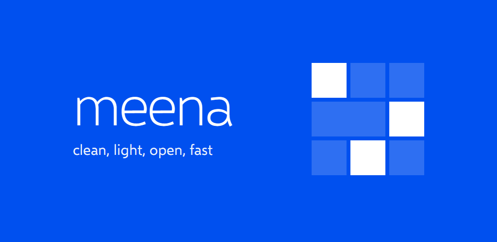

<p align="center">
  
</p>

<h1 align="center">Meena</h1>

<p align="center">A home screen for Android. Clean, light, open, fast.</p>

<p align="center">
  <a href="https://kotlinlang.org"></a>
  <a href="https://developer.android.com/jetpack/compose"></a>
  <a href="https://developer.android.com"></a>
  
  <a href="LICENSE"></a>
</p>



<p align="center">
  
  
  
</p>

Meena is an Android launcher built on its own design language, **Meena UI**: clean, light, open, fast. Big type, plenty of space, flat colour and square corners. No cards, no boxes, no made-up numbers. It is written in Kotlin with Jetpack Compose.

**Status:** 0.2.4 ([download from Releases](https://github.com/manaphassan/Meena-Launcher/releases/latest)). Getting ready for a Google Play closed test; it is not on the Play Store yet. What's next: [roadmap](docs/roadmap.md). What changed: [changelog](CHANGELOG.md).

- Website: https://manaphassan.github.io/Meena-Launcher/
- Privacy policy: https://manaphassan.github.io/Meena-Launcher/privacy-policy/
- Tester guide: https://manaphassan.github.io/Meena-Launcher/tester-guide/ (source: [docs/tester-guide.md](docs/tester-guide.md))

---

## Five pages

Swipe sideways through five pages.

| Page | What's on it |
|---|---|
| **today** | Clock, date and hijri date, with place, low and high, wind and next alarm. Weather with an animated icon and forecast. Up to eight favourite tiles, regular or small (four to a row, icon only), in your accent or each app's own colour; a tile can also be an app shortcut, such as a chat with one person (pick one in Meena, or use "add shortcut" in an app like WhatsApp), and one tile can hold four small apps. Your week from the calendar. JAKIM prayer times, with the zone picked from your location. A QR code and barcode scanner that keeps the scans you save. Notes, with tasks you can tick off. Screen time since midnight, with the apps you used most. Widgets from your other apps. A nearby map with 3 km and 5 km rings, compass, qibla line and sun path. Battery with charge speed, time to full and time left. Connected Bluetooth devices with battery. Health Connect steps, distance, calories, heart rate and sleep. |
| **inbox** | What's playing, with play, pause and skip; tap it for a full now playing page with the album art, a big title and a line to seek along. Chats, email and alerts from your notifications, grouped by app; tap an app to see all its alerts. Reply from the inbox when the app allows it, and see pictures people send. Read on the phone. |
| **news** | RSS and Atom feeds you choose, with pictures and a reader view. |
| **money** | **Markets:** a year of gold, silver, bitcoin and ether on one chart (daily prices from Frankfurter); search and add other coins and metals. **Kijang Emas** coin prices from Bank Negara Malaysia. **Exchange rates** in a table with the day's change; add any currency. **Portfolio and watchlist** from your own Google Sheet (`GOOGLEFINANCE`). **Spending** picked up from bank alerts. |
| **apps** | Every app with search and a letter index. Sort a to z, by category or by last used, or use the a to z filter to see one letter at a time. Icon packs. |

Every widget can be shown or hidden, moved to another page, or set to start folded. Today's widgets can be put in any order, and each inbox widget shows up to 12 items.

Settings has four tabs: **personalize** (quick switches, theme, wallpaper, text, icon pack, privacy and backup), **pages**, **connections** and **about**. Also there: **shake to hide** chats, email, alerts, notes and money (personalize), and **double tap to lock** an empty spot (about; off by default; uses Android's device admin with the lock-screen ability only). Swipe down from the top of a page to open the quick panel.

### Bursa stocks

There is no free stock price source Meena may use in a public app, so stock prices come from your own Google Sheet:

1. In Google Sheets, import [`docs/finance-sheet.csv`](docs/finance-sheet.csv) (file, import, upload; tick "convert text to numbers, dates, and formulas"). Edit the rows to your stocks. Codes are Google Finance's, like `KLSE:FFB` or `KLSE:SENHENG`, not the stock number.
2. Share it so anyone with the link can view.
3. Paste the link in Meena: settings, connections, money. Add the stocks you own as holdings there (units; cost is optional).

---

## Design rules

- **Type and space, not boxes.** Hierarchy comes from size and spacing. No cards, borders or shadows.
- **Square corners.** No rounded shapes, apart from icons that are circles themselves.
- **Real or nothing.** Each widget shows real information, or says it needs setup, is loading, is out of date, or failed. It never shows sample numbers.
- **Lowercase, short, plain.** All text is lowercase and in plain words.
- **Press feedback** is a slight scale and tilt, not a ripple.

---

## Privacy

- No ads, no accounts, no analytics.
- Notes, saved scans, portfolio, sheet link and keys are encrypted with an Android Keystore key. Backup is off.
- The scanner reads codes on the phone with ZXing. Camera pictures are never saved or sent.
- Weather gets your location rounded to about 1 km. The map libraries are bundled in the app.
- Notification text, pictures, replies, balances and health data stay on the phone.

The full list of online services and what each one receives is in the [privacy policy](docs/privacy-policy.md).

---

## Tech

- **Language:** Kotlin 2.3
- **UI:** Jetpack Compose (BOM 2026.03.01) with custom Meena UI tokens
- **Architecture:** single activity, `StateFlow`, coroutines
- **Storage:** AndroidX DataStore, with Keystore encryption for secrets
- **Network:** OkHttp, with a streaming XML parser for feeds
- **Health:** Health Connect
- **Scanner:** CameraX with ZXing (Apache 2.0), on the phone only
- **SDK:** min 24 (Android 7.0), target 36 (Android 16). Release builds are for ARM phones (arm64-v8a, armeabi-v7a)

---

## Build

You need Android Studio, JDK 17 and Android SDK 36.

| Flavour | What it is |
|---|---|
| `live` | The real app. This is what ships. |
| `demo` | Installs next to `live` as `my.hana.meena.demo` for side-by-side testing. It has no sample data. |

```bash
# debug build
./gradlew assembleLiveDebug

# unit tests and lint
./gradlew testDebugUnitTest lint

# install on a connected phone
./gradlew installLiveDebug

# release build, signed with the upload key in keystore.properties
# (first time: node scripts/make-upload-key.js)
./gradlew bundleLiveRelease
```

Store assets (icon, feature graphic, listing text) are in [`store/`](store/).

### Install the release APK

Download `meena-0.2.4.apk` from [Releases](https://github.com/manaphassan/Meena-Launcher/releases/latest) and open it on your phone (Android 7.0 or newer, ARM phones; allow installing from your browser when asked). Then pick Meena as your home app when it asks. It installs over 0.2.3 and every earlier 0.x build.

The APK is signed with Meena's upload key. When Meena reaches Google Play, Play signs it with a different key, so you'll need to uninstall this APK before installing from Play.

---

## Documents

| Document | What it is |
|---|---|
| [Roadmap and milestones](docs/roadmap.md) | Where Meena is, what's next, open decisions |
| [Changelog](CHANGELOG.md) | What each version added |
| [Development plan](docs/meena-ui-fix-plan.md) | Milestones, phases, decisions D1 to D17, integration notes |
| [UI plan v2](docs/meena-ui-fix-plan-v2.md) and [UI score](docs/meena-ui-score.md) | The Meena UI rubric and the 9.7 / 10 sign-off |
| [Privacy policy](docs/privacy-policy.md) | Every online service and what it receives |
| [Play compliance](docs/play-store-compliance.md) and [rollout guide](docs/play-store-rollout-guide.md) | Data safety answers, permissions, release checklist |
| [Tester guide](docs/tester-guide.md) and [task test plan](docs/task-test-plan.md) | For closed test testers, and the 5-person task test |

---

## Support

- Questions and bug reports: harussani@outlook.my, or open an issue.
- If Meena is useful to you, you can buy me a coffee at [paypal.me/manaphassan](https://paypal.me/manaphassan). Thank you!

---

## License

Apache License 2.0. See [LICENSE](LICENSE).
